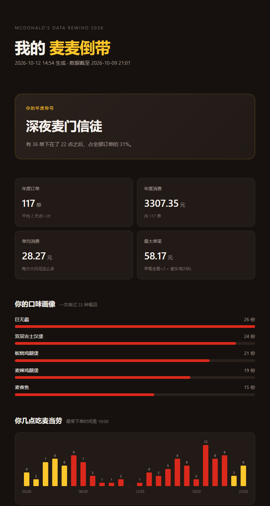
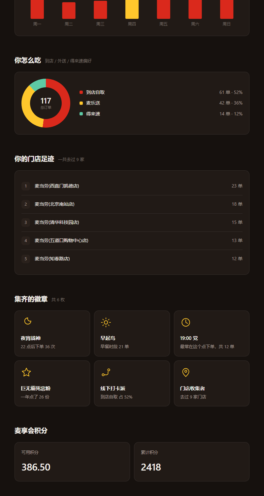
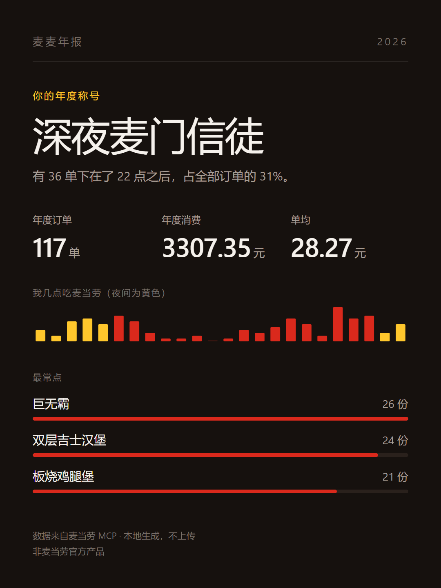

# 麦麦倒带 · McRewind

> 你在麦当劳花了多少钱、最爱点什么、几点吃最凶——一份能直接截图发出去的年度报告。

**麦麦倒带**是一个基于麦当劳 MCP Server 的 Skill：它读取你的真实订单历史，
在**本地**聚合成一份单文件 HTML 年报——年度称号、口味画像、24 小时下单热力、
渠道偏好、门店足迹、趣味徽章，全部一屏看完。

[]()
[]()
[]()

| 报告首页 | 图表与徽章 |
|---|---|
|  |  |

*（以上截图由内置演示数据生成，你可以不配置任何 Token 直接复现）*

---

## 为什么做这个

麦当劳 MCP 已经能查门店、查菜单、能下单，但有一个问题一直没人回答：

**"我这一年到底是个什么样的麦门用户？"**

订单数据一直躺在账户里，从来没有被讲成故事。麦麦倒带做的事情很简单——
把 `order-list` 返回的一串 JSON，变成一句你愿意截图的结论，比如：

> **深夜麦门信徒** —— 有 36 单下在了 22 点之后，占全部订单的 31%。

这类"结论"是社交货币。用户会把它发到群里、发到朋友圈——
而每一次转发，都是别人点进这个仓库的理由。

### 三个设计决策

1. **零外部依赖的单文件 HTML。** 不引 CDN、不加载网络字体、不请求任何图片。
   图表全部手写 SVG / CSS。原因：这类产品的核心动作是"截图 + 转发"，
   一个断网就打不开的报告没有传播力。
2. **数据不出本机。** MCP 采集 → 落盘成本地 JSON → 本地脚本分析渲染。
   全程没有任何网络上传，也没有任何服务器。
3. **空数据优雅降级。** 账号没下过单时不会报错，而是给一份体面的引导页，
   并提供 `--demo` 让你先用演示数据看效果。

---

## 快速开始

### 方式一：零配置看效果（不需要 MCP Token）

```bash
git clone https://github.com/Howardb570/mcrewind.git
cd mcrewind
python -m mcrewind --demo --card --card-png
```

一次生成两样东西：`mcrewind.html`（完整年报）和 `mcrewind-card.png`（竖版分享卡）。

### 方式二：在 WorkBuddy 里一句话生成（推荐）

前提：已按[麦当劳 MCP 配置指南](https://github.com/M-China/mcd-mcp-server)申请 Token，
并在 WorkBuddy 自定义连接器里启用 `mcd-mcp`。

把本仓库的 `SKILL.md` 安装为 WorkBuddy 技能，然后在对话框里说：

```text
生成我的麦麦倒带
```

Skill 会自动完成：调 MCP 采集订单 → 写入临时目录 → 运行分析脚本 → 打开报告。

### 方式三：手动喂真实数据

如果你已经在别处拿到了 MCP 的返回结果，直接喂给 CLI：

```bash
python -m mcrewind --orders orders.json --account account.json --out my.html
```

`orders.json` 就是 `order-list` 工具的**原始返回**，不需要做任何预处理。

---

## 报告里有什么

| 板块 | 内容 |
|---|---|
| 年度称号 | 一句话画像，如"深夜麦门信徒""早餐守门员""麦麦巡礼者" |
| 四项核心指标 | 年度订单数、年度消费、单均消费、最大单笔 |
| 口味画像 | 最常点餐品 Top 5（含套餐子项聚合） |
| 时段分布 | 24 小时下单柱状图，夜间时段用黄色高亮 |
| 一周规律 | 星期分布柱状图，高频日用黄色高亮 |
| 渠道偏好 | 到店自取 / 麦乐送 / 得来速 占比环形图 |
| 门店足迹 | 去过的门店排行 |
| 趣味徽章 | 最多 6 枚，每枚都带真实数字依据 |
| 麦享会积分 | 可用积分 / 累计积分（提供了 `account.json` 时显示） |

所有称号与徽章都是 **data-driven** 的：每一条都附带具体数字，
不是随机夸奖。数据稀薄时会降级为"麦门新朋友"这类新手标签，绝不输出空结果。

### 竖版分享卡

年报本体是横向长页面，发到社交平台会被压缩得看不清。所以麦麦倒带还会
额外产出一张**定尺竖版卡**（默认 1080×1440，即 3:4）——只保留年度称号、
三个核心数字、一条夜间热力条和最常点 Top 3。



```bash
python -m mcrewind --orders orders.json --card --card-png            # 默认 3:4
python -m mcrewind --demo --card --card-ratio 9:16 --card-png        # 快拍竖版
python -m mcrewind --demo --card --card-ratio 1:1  --card-png        # 方图
```

`--card-png` 会自动探测本机的 Edge / Chrome 做无头渲染导出 PNG；
找不到浏览器时优雅降级为只输出 HTML，不会报错中断。

---

## 项目结构

```text
mcrewind/
├── SKILL.md                  # WorkBuddy Skill 定义（智能体按此执行）
├── mcrewind/              # Python 包
│   ├── __main__.py           # CLI 入口：读文件 → 分析 → 渲染 → 写文件
│   ├── analyzer.py           # 聚合分析 + 字段容错
│   ├── persona.py            # 称号与徽章规则（传播引擎）
│   ├── render.py             # 单文件 HTML 渲染（手写 SVG/CSS 图表）
│   └── sharecard.py          # 竖版分享卡渲染（3:4 / 9:16 / 1:1）
├── tools/
│   ├── gen_demo.py           # 演示数据生成器（固定种子，可复现）
│   ├── export_workbuddy_md.py# 从 WorkBuddy 会话日志导出 workbuddy.md
│   └── check_redaction.py    # 公开前的脱敏与凭证自检
├── assets/
│   ├── demo/                 # 内置演示数据
│   └── screenshots/          # README 截图
├── examples/
│   ├── demo-report.html      # 预生成的示例报告
│   └── demo-card.png         # 预生成的竖版分享卡
├── workbuddy.md              # WorkBuddy 开发会话记录·精简脱敏版（专项奖励要求）
├── workbuddy.full.md         # 同一会话的完整版（含逐条工具调用轨迹）
├── MCP_INTEGRATION.md        # MCP 集成说明
├── mcp-config.example.json   # 脱敏配置示例
└── CONTEST_DECLARATION.md    # 参赛声明
```

依赖：**仅 Python 3.10+ 标准库，无需 pip install 任何东西。**

---

## 目标用户

- **麦门重度用户**：想知道自己这一年到底吃了多少、花了多少
- **点餐纠结者**：想借回顾找到自己的"本命套餐"
- **开发者**：想看一个"不写后端、不做服务器"的 MCP Skill 是怎么落地的
- **数据可视化爱好者**：想参考纯手写 SVG/CSS（无图表库）的实现方式

---

## 隐私说明

- 报告在你本地生成，**不上传任何数据**，没有服务器、没有埋点。
- `mcp-config.example.json` 只包含环境变量占位符，仓库中不含任何真实 Token。
- 生成的 HTML 里也不会包含你的 accountId、手机号等敏感字段。

## 已知限制

- `order-list` 工具不支持分页参数，能取到的订单深度以 MCP Server 实际返回为准。
- 商品聚合按 `productName` 文本匹配，若麦当劳调整商品命名，同一商品可能被拆成两条。
- 订单状态语义未在 MCP 文档中完整列出，脚本采用保守策略：仅剔除明确表示
  已取消/已退款的状态码，其余一律计入。

---

## 参赛说明

本项目为「麦当劳程序员创意开发大赛」参赛作品，使用 WorkBuddy 开发。
详见 [CONTEST_DECLARATION.md](CONTEST_DECLARATION.md) 与
[MCP_INTEGRATION.md](MCP_INTEGRATION.md)。

### WorkBuddy 开发会话记录

本项目从需求讨论到交付的全部过程都在 WorkBuddy 中完成，会话记录存放于：

| 文件 | 内容 |
| --- | --- |
| [`workbuddy.md`](workbuddy.md) | **精简脱敏版**：每次提问、用户决策、关键回复与执行摘要 |
| [`workbuddy.full.md`](workbuddy.full.md) | 同一会话的完整版，保留逐条工具调用轨迹 |

两份文件均由 `tools/export_workbuddy_md.py` 从 WorkBuddy 的会话原始日志
直接导出，未经人工撰写，可用同一命令复现：

```bash
python tools/export_workbuddy_md.py --brief --redact --out workbuddy.md   # 精简脱敏版
python tools/export_workbuddy_md.py --redact --out workbuddy.full.md      # 完整脱敏版
```

导出时已对本地文件路径、会话标识、账号余额等信息做脱敏或泛化处理。
推仓库前可跑一次公开前自检，确认没有本地环境指纹或真实凭证泄漏：

```bash
python tools/check_redaction.py
```

本项目为个人独立开发，**非麦当劳官方产品**；餐品信息、价格及供应状态
以麦当劳官方渠道的实时结果为准。

## License

[MIT](LICENSE)
